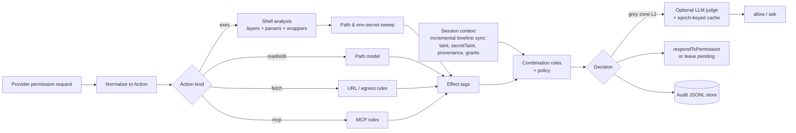

# Paseo Permission Guardian — Design

> Plugin ID: `paseo-permission-guardian`. Status: draft v0.2 (2026-11-08).
> A general-purpose Paseo plugin that classifies the risk of agent tool calls and answers
> routine permission prompts automatically, so humans only review the calls that matter.
>
> Key architectural decisions are recorded in [docs/adr/](./adr/README.md).

---

## 1. Summary

Coding agents managed by Paseo (Claude Code, Codex, OpenCode, Devin CLI and other ACP agents)
ask for permission before running commands, editing files, fetching URLs or calling MCP tools.
Teams currently choose between approving every prompt (slow, causes approval fatigue) and
bypass mode (fast, no guardrails).

This plugin sits on Paseo's permission flow and, for every pending request:

1. normalizes the provider-specific request into one `Action` model;
2. analyzes it **deterministically** — shell commands are parsed into ASTs (bash, PowerShell,
   cmd), wrapper commands such as `wsl`, `bash -c`, `cmd /c` are unwrapped recursively, and file
   paths are normalized across Windows, POSIX and WSL;
3. maps the result to **effect tags** (read, local write, delete, network egress, credential
   access, privilege, infra mutation, …) and applies **combination rules** alongside live
   session context (taint, secret taint, provenance, scope grants);
4. decides `allow`, `ask` or `deny`, optionally consulting an LLM only for the grey zone;
5. records every decision for audit, shadow-mode evaluation and replay testing.

The plugin is pure Node.js (no native binaries to install or sign), cross-platform, and
configuration-driven so it can be published to the Paseo plugin registry for any user.

## 2. Goals and non-goals

### Goals

- **Reduce human approvals** for routine, low-risk tool calls across all Paseo providers.
- **Never auto-allow** high-risk calls; keep humans in the loop where consequences are real.
- **First-class cross-platform support**: POSIX (`bash`/`sh`/`zsh` subset) first, followed by
  Windows PowerShell 5.1 & 7, `cmd.exe`, and WSL via `wsl.exe` with accurate path semantics
  ([ADR-0004](./adr/0004-cross-platform-shell-and-path-strategy.md)).
- **Deterministic first**: understand commands by parsing, not by regex over raw strings.
  LLM judgement is optional and confined to the grey zone
  ([ADR-0001](./adr/0001-deterministic-ast-first-with-effect-tags.md)).
- **Reuse proven rule data**: interpret `safe-chains`' declarative command definitions
  (MIT OR Apache-2.0) for cross-platform CLIs such as git, npm, cargo, kubectl, cloud CLIs,
  combined with mandatory path-model checks on arguments.
- **Safe rollout**: shadow mode by default, agreement metrics, replayable audit log.
- **Configurable** per user, team and (pinned) project without code changes.

### Non-goals

- Not a sandbox and not a security boundary. It reduces prompts; it cannot stop an agent that
  runs outside Paseo or a call the provider already auto-approved. Hard red lines belong in
  provider-native deny rules (Claude Code managed settings, Devin Team Settings, Codex config)
  and in OS or container isolation.
- Not a replacement for provider-native smart modes (Claude Code auto mode, Devin Smart mode).
  It complements them by handling the residual prompts with team-specific rules.
- No full coverage of every CLI in existence. Unknown commands are escalated, not guessed.

## 3. Background: what Paseo offers a plugin

Verified against Paseo plugin docs and source (`getpaseo/paseo`, server `0.16.x` / `0.17.0-beta`).
Hooks use `server.addHook(name, handler)`; this plugin targets `requirements.paseo: ">=0.16.0"`
(covering hooks, settings screens, `appendSystemPrompt`, and `agent.background`).

| Hook | Kind | Payload / Contract | Used for |
| --- | --- | --- | --- |
| `agent.permission.before` | notification (not awaited, 30 s timeout) | `{ agent, request }` | Classify the request; answer via `paseo.agents.ref(id).respondToPermission(...)` |
| `agent.permission.after` | notification | `{ agent, requestId, resolution }` (**no actor/decidedBy field**) | Reconcile final resolution with plugin's own answered map; compute agreement |
| `agent.create.before` | waiting (≤ 30 s) | `{ request: { config, env?, metadata } }` | Optional mode policy, e.g. downgrade `bypassPermissions`, strip ACP `auto_accept` |
| `agent.open.before` | waiting (≤ 30 s) | `{ request }` | Optional `appendSystemPrompt` (non-ACP providers; Codex ≥ 0.121.0) and launch `env` |
| `agent.turn.after`, timeline API | notification / SDK | `{ agent, turnId, outcome }` + `timeline.refetch(...)` | Turn cleanup and incremental session-context sync (taint, modified files) |

Permission request shape (`AgentPermissionRequest`):

```ts
{ id, provider, name, kind: "tool"|"plan"|"question"|"mode"|"other",
  title?, description?, input?, detail?, suggestions?, actions?, metadata? }
```

Response: `{ behavior: "allow", selectedActionId?, updatedInput?, updatedPermissions? }` or
`{ behavior: "deny", message?, interrupt? }`. Responding to an already-resolved request fails;
if the plugin does not respond, the request stays pending for the user.

Provider specifics and platform constraints ([ADR-0003](./adr/0003-paseo-integration-and-config-source-of-truth.md)):

- **Claude Code** (Agent SDK `canUseTool`): `name` is the tool name (`Bash`, `Write`, `Edit`,
  `WebFetch`, `mcp__server__tool`, …) and `input` is the tool input (`command`, `file_path`, `url`).
  Paseo's Claude modes include `auto` (classifier) when the Anthropic API is used.
- **ACP agents** (first-class targets: **Antigravity** and **Devin CLI** via `devin acp`;
  other ACP agents such as Cursor / Gemini CLI follow the same schema): `name` is the ACP tool
  kind (`execute`, `edit`, `read`, `fetch`, …); the raw input lives in
  `metadata.rawRequest.toolCall.rawInput`; `actions` lists the agent's options
  (`allow_once`, `allow_always`, `reject_*`). **Note**: Paseo's ACP adapter does not forward
  `appendSystemPrompt` instructions to ACP providers.
- **Codex / OpenCode**: own approval payloads; handled by dedicated adapters. Codex
  `appendSystemPrompt` requires Codex ≥ 0.121.0.
- **Concurrency & ordering**: Paseo may invoke notification hooks concurrently for parallel
  tool calls, and completion order is not guaranteed. All shared state, parser hosts, and
  audit reconciliation must be concurrency-safe.
- **Known limitation**: Because `agent.permission.before` is a notification, the approval card
  and push notification can surface before the plugin answers. See §12.3 for the upstream
  proposal.

## 4. Threat model

The plugin targets the realistic failure modes of coding agents:

| Threat | Example | Primary defence |
| --- | --- | --- |
| Overeager behaviour | Agent force-pushes to "fix" a rejected push | Effect tags + human-required rules |
| Honest mistakes | `Remove-Item -Recurse` (or `-Rec`) on the wrong directory | Path model, prefix disambiguation, reversibility rules |
| Prompt injection | Issue text instructs agent to POST `.env` to a URL (single-call or split-call) | Same-turn taint & `secretTaint` tracking + secret→egress rules |
| Self-escalation | Agent edits its own permission config, `.git/`, or this plugin's policy | Protected paths, never auto-allowed |

Out of scope: a malicious human user, a compromised Paseo daemon, and calls that never reach
Paseo's permission flow.

## 5. Architecture



Module layout (aligned with Paseo plugin runtime boundaries: `client/`, `server/`, `shared/`):

```text
paseo-permission-guardian/
  paseo-plugin.json
  OVERVIEW.md              # Required for Paseo plugin registry listing
  package.json
  tsconfig.json
  index.server.ts          # hook, settings, and RPC wiring
  index.client.tsx         # settings screen, shadow dashboard, timeline renderer
  docs/
    README.md
    DESIGN.md
    adr/
  shared/
    settings.ts            # defineSettings schema (UI-owned runtime controls)
    rpc.ts                 # defineRpc contracts (audit metrics, policy status, replay)
    types.ts               # shared DTOs (no Node / RN imports)
  client/
    settings-screen.tsx    # SettingsCard/SettingsSection UI
    gate-view.ts           # pure gate-status view helpers (labels, integrity)
    dashboard.tsx          # Shadow dashboard & disagreements view
    timeline-row.tsx       # Compact risk/verdict timeline renderer
  server/
    normalize/             # claude.ts, acp.ts, codex.ts, opencode.ts → Action
    shell/
      layers.ts            # recursive layer analysis + wrapper unwrapping
      bash.ts              # web-tree-sitter + tree-sitter-bash (WASM)
      pwsh.ts              # serialized persistent PowerShell host (UTF-8, timeout, circuit breaker)
      pwsh-fallback.ts     # conservative opaque fallback when no PowerShell host is available
      cmd.ts               # conservative cmd.exe tokenizer
    knowledge/
      sc-registry/         # safe-chains TOML interpreter + vendored data + path sweep
      pwsh-verbs.ts        # verb taxonomy, alias table, parameter prefix disambiguation
      windows-builtins.ts  # del, rd, reg, sc, schtasks, robocopy, icacls, …
      handlers/            # JS ports for commands needing code (curl, …)
    paths/                 # normalization, ancestor realpath, WSL mapping, sensitive/protected catalogs, Paseo self subpaths (R11)
    secrets/               # stateless credential literal patterns & env var classifiers (ADR-0005)
    context/               # incremental timeline sync, taint, secretTaint, provenance, scope grants,
                           # git-state.ts (tracked+clean lookup for deletes, ADR-0009)
    effects.ts             # effect vocabulary + combination rules
    policy/                # layered YAML loading, schema, project sha256 pinning
    decide.ts              # levels, LLM grey zone, epoch-keyed LLM cache, actor tracking
    audit/                 # rotated JSONL store, redaction, in-memory metrics index, window reader
    gate/                  # evidence gate: fingerprint, replay, latch/suspension state machine
    act/                   # act responder (allow-once/deny-once mapping, attribution marks)
  test/
    vectors/safe-chains/   # extracted conformance cases
    vectors/windows/       # PowerShell, cmd, WSL cases
    replay/                # user-supplied audit replays
```

## 6. Action model

```ts
type Shell = "bash" | "pwsh5" | "pwsh7" | "cmd" | "argv";

interface Action {
  provider: string;
  agentId: string;
  requestId: string;
  kind: "exec" | "read" | "edit" | "delete" | "fetch" | "mcp" | "plan" | "question" | "other";
  host: { os: "windows" | "darwin" | "linux"; wsl?: { distro: string; user?: string } };
  cwd: string;              // normalized
  worktreeRoot?: string;    // from Paseo workspace / git
  exec?: { shell: Shell; source: string };
  paths?: string[];         // normalized, ancestor-resolved realpath where applicable
  url?: { href: string; method?: string; hasBody?: boolean };
  mcp?: { server: string; tool: string; args: unknown };
  raw: unknown;             // original request, for redacted audit only
}
```

Shell detection: tool name (`Bash`, `PowerShell`, ACP `execute`), provider metadata, host OS
and configured defaults. When the shell cannot be determined, the plugin escalates rather than
guessing.

`question`, `plan` and `mode` requests are never auto-answered.

## 7. Shell analysis

### 7.1 Layers

A command is analyzed as a stack of **layers**, each with its own grammar and context:

```ts
analyze(layer: Shell, source: string, ctx: LayerContext): LayerResult
// LayerContext: { os, distro?, user?, cwd, home, depth, env hints }
// LayerResult : { commands: CommandFacts[], effects: EffectTag[], opaque: Reason[] }
```

Each parser produces simple commands (name, argv, redirections, assignments, env reads). Wrapper
commands (`cmd /c`, `start`, `wsl`, `powershell -c`, `bash -c`, `env -S`) preserve outer
`redirections` / `envReads` at their own layer before producing a **child layer** with an adjusted
context and `depth + 1`. Results from all layers are merged before combination rules run, so
cross-layer patterns (e.g. Windows reads a secret, WSL sends it out) are still caught. Maximum depth: 3.
Beyond that the call is opaque.

### 7.2 Parsers

| Shell | Parser | Notes |
| --- | --- | --- |
| bash / sh / zsh (subset) | `web-tree-sitter` + `tree-sitter-bash` (WASM) | Extract every simple command across `&&`, `||`, `;`, pipes, subshells, `$(...)`, backticks, process substitution, heredocs, redirections, variable expansions |
| PowerShell | Official parser in a persistent host: `System.Management.Automation.Language.Parser.ParseInput` | Exact grammar of the executing shell (5.1 vs 7). Launched via verified absolute system path (`SystemRoot`/`ProgramFiles` validated) with minimal sanitized env, system-dir `cwd`, `windowsHide: true`, short `-EncodedCommand` bootstrap + full script streamed over UTF-8 `stdin` pipes ([ADR-0006](./adr/0006-windows-env-classification-shell-hardening-and-static-cwd.md)); on Windows PowerShell 5.1 the transport is an authenticated named pipe with `stdin` ignored, and the 5.1 startup path uses no cmdlets (`[Type]::new()` only) ([ADR-0007](./adr/0007-pwsh5-named-pipe-transport-and-cmdlet-free-cold-start.md)), `-NoProfile -NonInteractive`, **bounded serialized request queue** (depth 64, 2 MiB line limit), per-request timeout (1500 ms warm / 10 s cold, 20 s cold on 5.1), crash restart + circuit breaker, parse-only. Walks nested blocks via `Ast.FindAll({$true}, $true)` with a versioned `nodeTypeCensus` (unknown AST node or non-empty `ParseError[]` → `opaque`). All unrecognized static/instance `.NET` member calls, non-literal type expressions, nested `scriptBlockDepth > 1` cwd changes, dynamic cmdlet arguments, and dynamic `-WhatIf:$var` values fall back to `opaque`. Can be disabled via `shells.pwshHost: "disabled"` ([ADR-0004](./adr/0004-cross-platform-shell-and-path-strategy.md)). |
| PowerShell (fallback) | Conservative opaque fallback | Used on non-Windows hosts, under WDAC Constrained Language Mode, or when `pwshHost` is disabled; all PowerShell commands emit `opaque` (no PowerShell WASM grammar bundled) |
| cmd.exe | Conservative tokenizer | Splits on `&`, `&&`, `||`, `|` and redirections with quote and `^` handling ([ADR-0006](./adr/0006-windows-env-classification-shell-hardening-and-static-cwd.md)). Safe system macros in argument position pass deterministically under strict 4-point guardrails + Path Model sweep; non-allowlisted `%var%`, `!var!`, `for /f`, `call`, substring modifiers, and nested `cmd /c` → `opaque`; bare `set`/`set PREFIX` → `env_dump`; `cwd` shadow binaries checked against `PATHEXT`. |

The PowerShell host extracts `CommandAst` (via `GetCommandName()` against backtick obfuscation),
`CommandParameterAst`, `InvokeMemberExpressionAst`, `VariableExpressionAst` (`$env:*`),
`AssignmentStatementAst`, `RedirectionAst`, `ScriptBlockAst`, `nodeTypeCensus`, and `--%` stop-parsing spans.

### 7.3 Wrapper unwrapping

| Wrapper | Child layer |
| --- | --- |
| `bash -c`, `sh -c`, `zsh -c` | bash, argument string |
| `cmd /c`, `cmd /k` | cmd |
| `powershell -Command`, `pwsh -c`, `-File` | pwsh (file → provenance check) |
| `powershell -EncodedCommand` (and `-ec` / `-e` / prefix forms) | opaque (escalate) |
| `wsl [opts] <cmdline>`, `wsl -- …` | bash inside the distro (default shell) |
| `wsl -e/--exec …` | argv inside the distro; recurse if it is a shell with `-c` |
| `bash.exe -c`, `<distro>.exe run` | as `wsl` |
| `Start-Process <exe> -ArgumentList` | argv / matching layer |
| `env`, `timeout`, `nice`, `nohup`, `xargs`, `find -exec`, `git -c`, `sudo` | argv; `sudo` and `wsl -u root` add `privilege` |
| `npx`, `pnpm dlx`, `uvx`, `pipx run` | `exec_network_sourced` unless pinned and allow-listed |

**WSL specifics**

- The outer AST decides argument boundaries. In PowerShell, `wsl ls | grep x` pipes into a
  Windows-side `grep`; only `wsl "ls | grep x"` pipes inside Linux.
- Options shape the child context: `-d` (distro), `-u` (user; root ⇒ `privilege`, home `/root`),
  `--cd` (cwd, Windows or Linux path). Windows-side assignments and `WSLENV` secret/hijack exports
  propagate across the boundary ([ADR-0006](./adr/0006-windows-env-classification-shell-hardening-and-static-cwd.md)).
- Linear static literal `cwd` tracking resolves sequential `cd`/`pushd`/`popd` and single-command
  flags (`env -C`, `git -C`, `npm --prefix`, `wsl --cd`) deterministically, falling back to `opaque`
  on conditional/dynamic/drive changes ([ADR-0006](./adr/0006-windows-env-classification-shell-hardening-and-static-cwd.md)).
- Management commands are classified separately: `--unregister` ⇒ deny (irreversible);
  `--mount`, `--import`, `--export`, `--set-default`, `--install`, `--shutdown`,
  `--terminate` ⇒ human.
- Inside WSL, Windows interop (`cmd.exe`, `powershell.exe`) recurses back to Windows layers.

### 7.4 Opaque constructs

Opaque is not "dangerous"; it means "cannot be understood statically". Opaque calls go to the
grey zone (LLM or human), never to auto-allow. Triggers include: parse errors; dynamic command
names (`$CMD args`, `& $x`); `eval`, `Invoke-Expression`/`iex`; `source`/dot-sourcing of
non-tracked files; inline code (`python -c`, `node -e`, `Add-Type`); `-EncodedCommand`;
obfuscation (long base64, `\x` escapes, char-code joins); splatting from unknown variables;
ambiguous PowerShell parameter abbreviations; COM objects; depth limit exceeded.

## 8. Command knowledge

### 8.1 `safe-chains` registry interpreter

`safe-chains` (`michaeldhopkins/safe-chains`, MIT OR Apache-2.0) ships ~1,268 declarative TOML
command definitions; all but 29 are fully declarative (the rest reference Rust handlers).
The plugin vendors the TOML data with attribution and implements an interpreter for the schema
documented in `commands/SAMPLE.toml`: `sub` (nested), `bare`, `bare_flags`, `standalone`,
`valued`, `max_positional`, `guard`, `first_arg`, `require_any`, `write_flags`, `wrapper`,
`delegate_*`, `allow_all`, `deny`, aliases, `tolerate_unknown_*`.

- Command names are normalized before lookup (lowercase and `.exe`/`.cmd`/`.bat` stripped on
  Windows).
- Levels map to effect baselines: `Inert` → `read`, `SafeRead` → `exec_project_readonly`,
  `SafeWrite` → `write_local`.
- **Mandatory path & env-secret sweep** ([ADR-0004](./adr/0004-cross-platform-shell-and-path-strategy.md)):
  Because `safe-chains` TOML definitions do not tag which arguments are filesystem paths, every
  `SafeRead` / `SafeWrite` match must still pass all positional arguments and path-like flag
  values (`-f`, `--file`, `-C`, `--config`, `-i`, `-o`, etc.) through the Path Model to detect
  sensitive or protected paths before assigning `L0`.
- Commands that require handlers (e.g. `curl`, `perl`) get JS handlers over time; until then
  they are treated as unknown.
- A sync script pulls new upstream data releases; conformance tests (§13) gate updates.
- The registry is an **allow-list**: a command or flag it does not list is not auto-allowed.

### 8.2 PowerShell knowledge

- **Alias resolution** first (`rm`, `del`, `ri`, `iwr`, `irm`, `iex`, `gc`, `sc`, and in 5.1
  `curl`/`wget` → `Invoke-WebRequest`).
- **Parameter prefix disambiguation & positional parameters**: Resolve PowerShell unique-prefix
  abbreviations (e.g. `-Rec` → `-Recurse`, `-Me` → `-Method`, `-Ep` → `-ExecutionPolicy`; note `-M`
  on `Invoke-RestMethod` is ambiguous against `-MaximumRedirection` and safely triggers `opaque`)
  via explicit per-cmdlet switch/valued parameter schemas; treat ambiguous, unrecognized, dynamic
  colon/positional arguments, or unrecognized `.NET` member invocations as `opaque`.
- **Verb taxonomy** as the baseline: `Get/Test/Measure/Select/Find/Resolve/Compare/Format/Out-Host`
  → read; `New/Set/Add/Copy/Move/Rename/Clear/Remove/Start/Stop/Restart/Invoke/Install/Uninstall/Register/Unregister/Enable/Disable`
  → write/exec, refined by noun, parameters and paths.
- **High-risk constructs**: `Remove-Item -Recurse`; provider paths `HKLM:`/`HKCU:`/`Cert:`;
  `Set-ExecutionPolicy` and `$env:PSExecutionPolicyPreference=Bypass|Unrestricted` (`L2`), `-ExecutionPolicy Bypass`;
  `Invoke-WebRequest`/`Invoke-RestMethod` with `-Method Post/Put`, `-Body`, `-InFile`, `-UseDefaultCredentials`;
  .NET calls (`[IO.File]::ReadAllText`/`Delete`, `[IO.Directory]`, `[Diagnostics.Process]::Start`, `[Microsoft.Win32.Registry]`, `[Reflection.Assembly]`, `[Net.WebClient]`, `[Environment]::SetEnvironmentVariable` User/Machine; any unrecognized call → `opaque`);
  `Start-Process -Verb RunAs`; credential & `Win32_Process.CommandLine` queries; `Get-ChildItem Env:` /
  `$env:*` secret reads ([ADR-0006](./adr/0006-windows-env-classification-shell-hardening-and-static-cwd.md)).
- Explicit parameterless `-WhatIf` (or strictly `-WhatIf:$true`) on cmdlets that honour it lowers the effect to a preview (`$WhatIfPreference=$true` and dynamic `-WhatIf:$var` never lower effects).

### 8.3 Windows built-ins

A hand-written table for cmd and system tools: `del /s`, `rd /s`, `format`, `robocopy /MIR`,
`reg add/delete`, `sc`, `schtasks`, `net user`, `icacls`, `takeown`, `vssadmin`, `bcdedit`,
`diskpart`, `cmdkey`, `setx` (P7 persistent env write), `winget`, `choco`, `msiexec`, plus
explicit `credential_dump` signatures (`procdump -ma lsass`, `rundll32 comsvcs.dll,MiniDump`,
`reg save/export HKLM\{SAM,SECURITY,SYSTEM}`, `ntdsutil ... ifm`, shadow-copy SAM extraction).

## 9. Path model

Correct paths are the foundation of "inside the worktree?" and "credential store?" decisions.

**Normalization**

- Windows: case-insensitive comparison, drive letters, `/` vs `\`, `\\?\` prefixes, UNC/WebDAV paths
  (remote UNC triggers automatic NTLM egress with path-boundary `inWorktree` checks, [ADR-0006](./adr/0006-windows-env-classification-shell-hardening-and-static-cwd.md)),
  trailing dot/space stripping (except `\\?\`), reserved device names (`NUL`, `CON`),
  8.3 short names (`PROGRA~1`), multi-segment alternate data streams (`file::$DATA`, intermediate `.git::$INDEX_ALLOCATION`, `Zone.Identifier` removal), shell-scoped
  allowlisted env macro expansion (`%USERPROFILE%`, `$env:USERPROFILE`, `~`; arbitrary/secret env vars never expanded),
  PowerShell provider drives (`Env:`, `HKLM:`, `Cert:` are not files). DrvFs (`/mnt/<drive>/`) and MSYS/Cygwin
  (`/c/`, `/cygdrive/<drive>/`) paths match sensitive/protected catalogs case-insensitively regardless of host OS
  when running under `bash`.
- POSIX: `~`, `$HOME`, `..`, symlinks.
- **Ancestor-resolved real paths** ([ADR-0004](./adr/0004-cross-platform-shell-and-path-strategy.md)):
  Use `fs.realpathSync.native` when the path exists; when the target does not yet exist (e.g.
  `Write`, `mkdir`, redirection), walk up to the nearest existing ancestor, resolve its real
  path, and re-append the remaining segments so symlinked parent directories cannot escape the
  worktree.

**WSL mapping (both directions)**

- `C:\repo` ⇄ `/mnt/c/repo` (respecting the distro's automount root).
- `\\wsl$\<distro>\…` and `\\wsl.localhost\<distro>\…` ⇄ Linux paths in that distro.
- Home depends on the WSL user (`-u root` ⇒ `/root`).
- **Avoid waking stopped WSL VMs**: perform lexical normalization and sensitive-path matching
  first; skip `realpath` syscalls on `\\wsl$\` / `\\wsl.localhost\` unless the distro is
  already running.

**Sensitive path catalog** (policy-extensible), evaluated on the mapped path in *both* worlds:
`~/.ssh`, `~/.aws`, `~/.azure`, `~/.kube`, `~/.config/gcloud`, `~/.docker/config.json`,
`~/.npmrc`, `~/.pypirc`, `~/.netrc`, `~/.git-credentials`, `.env*`, `*.pem`, `*.pfx`, `*.key`,
`%APPDATA%\Microsoft\Credentials`, browser profiles, `/etc/shadow`, `/etc/sudoers`.

**Protected paths** (never auto-allowed for writes): agent configs (`.claude/`, `.devin/`,
`.codex/`, `.cursor/`), the entire `.git/` directory (covering hooks, config, `info/attributes`,
modules), CI configs, shell startup files, PowerShell profiles, package-manager configs
(`.npmrc`, `.pip/pip.conf`), startup folders, scheduled-task and service definitions, and this
plugin's own policy, settings, and data files.

## 10. Effects, context and decisions

### 10.1 Effect vocabulary

| Tag | Meaning |
| --- | --- |
| `read` | Reads ordinary files / metadata |
| `read_secret` | Reads a sensitive path, credential store, or sensitive env vars / full env dumps / `WSLENV` secret exports / `Win32_Process.CommandLine` / literal credentials ([ADR-0005](./adr/0005-env-classification-and-bash-ast-hardening.md), [ADR-0006](./adr/0006-windows-env-classification-shell-hardening-and-static-cwd.md)) |
| `write_worktree` | Creates/modifies files inside the worktree |
| `write_outside` | Writes outside the worktree (excluding temp) |
| `write_protected` | Writes a protected path or persistent environment target (P7: `setx`, `User`/`Machine` env, `Set-ExecutionPolicy`) |
| `delete_worktree` / `delete_outside` | Deletes files |
| `exec_project` | Runs project code (tests, builds, scripts) |
| `exec_inline` / `exec_network_sourced` | Runs inline code / env execution hijacks (P3) / code fetched from the network |
| `pkg_install` | Installs dependencies (may run install scripts) |
| `net_read` / `net_egress` | Fetches / sends data off the machine (incl. remote UNC/WebDAV NTLM) |
| `vcs_remote` | Push, force-push, remote branch deletion, releases |
| `infra_read` / `infra_mutate` | Cloud, Kubernetes, IaC, databases (with target) |
| `privilege` | sudo, `-u root`, RunAs, service/registry/system config |
| `system_destructive` | Disk, boot, shadow copies, distro unregister, explicit `credential_dump` signatures (LSASS/SAM) |
| `opaque` | Not statically understood |

Each tag carries attributes: target (path, host, context), reversibility, and source layer.

### 10.2 Context signals

See [ADR-0002](./adr/0002-session-context-taint-and-cache-invalidation.md) for rationale.

- **Incremental same-turn sync**: On context-sensitive permission requests (`exec`, `net_egress`,
  `vcs_remote`), incrementally read new entries from the agent's timeline since the last synced
  cursor so same-turn tool calls (including provider-auto-approved `Read`/`Edit`/`WebFetch`)
  are reflected immediately, not only after `agent.turn.after`.
- **Targeted provenance**: Upgrade `exec_project` to `exec_inline` when executing a directly
  modified script/file, or when build/task entrypoints (`package.json`, `Makefile`,
  `pyproject.toml`, `scripts/**`, test runner configs) were modified in the session. Ordinary
  source-file edits do not block allow-listed test commands.
- **Untrusted taint (`untrustedTaint`)**: After the session reads untrusted external content
  (web pages, issue bodies, fetched documents, MCP results from untrusted servers), raise
  `net_egress`, `exec_*` and `vcs_remote` by one level for the rest of the turn or session.
- **Secret taint (`secretTaint`)**: After the session reads a sensitive path or sensitive env
  vars (`read_secret`), elevate subsequent `net_egress` calls in the session to at least `L2`
  (`ask`) — or `L3` (`deny`) if configured — to catch split-call exfiltration.
- **Scope grants**: User-declared task scopes ("may run migrations against local postgres")
  stored in agent metadata; matching actions are downgraded, never beyond the policy ceiling.

### 10.3 Combination rules (examples)

| Rule | Result |
| --- | --- |
| `read_secret` + `net_egress` anywhere in the call (any layer) | deny |
| `secretTaint` active + `net_egress` in a later call | ask (or deny by policy) |
| `net_read` piped into an interpreter (`curl \| sh`, `iwr \| iex`) or combined with `Invoke-Expression` / `[scriptblock]::Create` (`iex (iwr ...).Content`) | deny |
| `infra_mutate` on a target not in `trusted.environments` | human |
| `vcs_remote` force or to a protected branch | human |
| `write_protected` | human (deny for this plugin's own files) |
| `delete_outside` with recursion | deny |
| `system_destructive` | deny |
| any `opaque` | grey zone |

### 10.4 Levels and decision

| Level | Typical effects | Decision |
| --- | --- | --- |
| L0 | `read`, `write_worktree`, `exec_project` (allow-listed, entrypoints unmodified), `net_read` to trusted domains, non-recursive `delete_worktree` of git-tracked files with no uncommitted changes | allow (select the provider's **allow-once** option; never "always") |
| L1 | unknown commands, opaque, `pkg_install`, `write_outside` to temp-like dirs, unlisted MCP tools, recursive `delete_worktree`, non-recursive `delete_worktree` of an uncommitted/untracked/ignored target (`delete_uncommitted:<path>`) | grey zone → LLM judge (if enabled) may return allow or ask; default ask |
| L2 | `vcs_remote`, `infra_mutate`, `privilege`, `write_protected`, untrusted egress, `secretTaint` egress | ask (human) |
| L3 | combination-rule denies, `system_destructive` | deny with an explanatory message the agent can act on |

Rules:

- The highest level across all effects wins; deterministic L2/L3 can never be lowered by the LLM.
- Any internal error, timeout or unsupported provider payload ⇒ leave pending (ask). The plugin
  fails *to the human*, never to allow, and never denies on error.
- **No cross-state caching for deterministic rules**: deterministic evaluation runs fresh on
  every request. Only LLM judge responses may be cached, keyed by
  `(normalizedActionHash, policyVersion, taintEpoch, worktreeMutationEpoch, scopeGrantVersion)`.
- Deny can be downgraded to ask globally by policy for teams that prefer no auto-deny.
- **Uncommitted deletes** ([ADR-0009](./adr/0009-uncommitted-delete-requires-human.md)): a
  non-recursive `delete_worktree` (bash `rm`, PowerShell `Remove-Item`, cmd `del`/`erase`, provider
  `delete`) is L0 only if every target is a regular tracked git entry with no worktree/index
  changes. `server/context/git-state.ts` asks `git` (`execFile`, no shell, inherited `GIT_*`
  removed, `GIT_OPTIONAL_LOCKS=0`, literal pathspecs, fsmonitor/untracked cache off, 1500 ms
  budget, hook signal) about the entry `rm` removes (parent realpath + kept basename, so a symlink
  is judged as the link). A raw target with a `..` segment is never clean (no git call). Anything else — untracked, ignored, modified,
  staged, outside the worktree or repository, not a repo, git error/timeout — is L1
  `delete_uncommitted:<path>`. The provider is injected (`gitStateProvider`); `decideAction` never
  spawns git itself. Replay uses the recorded `contextSnapshot.deleteTargetsClean` and never calls
  git; keys are the redacted lexical target paths (no host realpath), which replay reproduces
  exactly. A missing entry (e.g. legacy records) is not clean.

**What `act` answers** ([ADR-0008](./adr/0008-act-mode-evidence-gate.md)): only when the effective
mode is `act` (the evidence gate is open, see §12.1/§13.2). L0 `allow` is answered with the
provider's allow-once option. L3 `deny` is answered with a deny-once option and an explanatory
message only when `denyAsAsk` is off and the gate shows zero false-denies in the window; otherwise
L3 stays with the human. L1/L2, `neverAutoAnswer` decisions, and question/plan/mode requests are
never answered. Options are chosen by explicit per-provider id mapping (`server/act/actions.ts`);
persistent-looking options, ambiguous or missing ids, and providers without a mapping produce no
answer. The persistence-option pattern treats `all` as a standalone word only (so agy's `allow`
is not mistaken for it). Only provider `agy` is auto-answered in this version.
`updatedInput`/`updatedPermissions` are never sent.

### 10.5 Optional LLM judge

- Input: truncated/summarized user task intent, the normalized action, deterministic findings
  and reasons. Tool outputs and assistant prose are excluded to limit prompt-injection reach
  (note: user messages with pasted/attached external content remain partially untrusted, so
  the LLM can never override L2/L3 or return `deny`).
- Output: `allow` or `ask` with a one-line reason.
- Must propagate Paseo's `context.signal` combined with a short request timeout (3–5 s).
- Pluggable backends (Anthropic, OpenAI-compatible, local). Disabled by default.
- **UX note**: Until Paseo adds a waiting permission hook (§12.3), a 1–3 s LLM call can cause
  approval cards to flash and disappear. Clearly surface this trade-off in Settings.

## 11. Configuration and policy

Clear Source of Truth ([ADR-0003](./adr/0003-paseo-integration-and-config-source-of-truth.md)):

- **Paseo Settings (`defineSettings`, host scope)**: Stores runtime controls edited in the UI —
  `mode` (`off | shadow | act`), `denyAsAsk`, `llm` enable/provider/model, local policy file
  paths, pinned project sha256 hashes, and timeline verbosity (`off | notable | all`).
- **Act gate settings** (P2a): `actGate.minSamples` (default 200, 20-5000), `actGate.windowDays`
  (default 30, 1-365), `actGate.autoFallbackOnFalseAllow` (default on; when off, false-allows are
  reported but never change the effective mode), `actGate.allowOverride` (default on), and
  `actOverride { accepted, acceptedAt, fingerprint }`. The settings screen fills the fingerprint
  from `guardian.status` when the user accepts the override; the override skips only the sample
  count, is bound to the current engine fingerprint, never applies while the gate is
  `replaying`/`unavailable`, and is audited. Invalid settings keep the plugin in `shadow`.
- **Layered YAML Policy**: Stores declarative rules; later layers override earlier ones, and
  deny/human rules from any layer cannot be relaxed by a later layer. The UI never rewrites YAML
  files:
  1. Built-in defaults (conservative).
  2. User: `~/.paseo/permission-guardian/policy.yaml`.
  3. Team: a local file path configured in Settings (distributed by teams via Git, dotfiles, or
     MDM; no remote HTTP fetch).
  4. Project: `.paseo-guardian.yaml` in the repo — **ignored unless pinned** by sha256 in
     Settings or team policy; any change un-trusts it until re-pinned.

```yaml
trusted:
  domains: [registry.npmjs.org, pypi.org, github.com, "*.internal.example.com"]
  environments:
    kube: [kind-dev, docker-desktop]
    databases: [localhost, 127.0.0.1]
  mcp:
    - { server: github, tools: [list_issues, get_issue, get_pull_request], level: L0 }
    - { server: github, tools: [merge_pull_request], level: L2 }

paths:
  sensitive: ["~/.config/acme/token", "%APPDATA%\\Acme\\*"]
  protected: ["deploy/**"]

commands:            # extra registry entries, same schema as safe-chains TOML, in YAML
  - name: acmectl
    sub:
      - { name: status, valued: [--env] }
      - { name: deploy, level: L2 }

shells:
  windowsDefault: pwsh7      # pwsh5 | pwsh7 | cmd
  pwshHost: auto             # auto | disabled (for EDR-restricted Windows hosts)
  wsl: { enforceCanonicalForm: true }
```

`enforceCanonicalForm` makes any `wsl` invocation that is not
`wsl -d <distro> -e bash -c '<command>'` a human decision, removing quoting ambiguity between
PowerShell versions.

## 12. Paseo integration

### 12.1 Hooks

- `agent.permission.before`: await the audit history load (so gate state is known), take a context
  snapshot, run the pipeline, record the request in memory first (disk append is asynchronous), and
  in `act` mode answer through the responder (`server/act/responder.ts`): stop if an `after` event
  already resolved the request, re-check the effective mode and `context.signal` immediately before
  sending, then the responder marks the request in its own in-memory mark table (behavior,
  `selectedActionId`, send time) and records `actOutcome: "sent"`, then calls
  `respondToPermission` with the mapped allow-once/deny-once option. The call is fire-and-forget
  (the daemon client only sends a frame), so success is inferred from `after`, never from the call;
  a thrown error unmarks the request and records `actOutcome: "error"`. In `shadow` mode only record.
  `PermissionGuardianService.markAnsweredByPlugin` and its `answeredByPlugin` map are legacy: they
  are used for attribution only when no responder is configured, and are unused in the shipped
  wiring (which always has a responder).
- `agent.permission.after`: also awaits history load; reconcile by `requestId` (upsert/merge to
  handle out-of-order delivery). **Attribution window**: the actor is `plugin` only if the request
  was marked, `behavior` and `selectedActionId` equal what was sent, and the event arrives within
  15 s of sending; a matching event later than that is attributed to the human. A marked request
  with a different resolution is `human` with `actOutcome: "lost_race"`; no `after` in the window is
  `unconfirmed`. Three consecutive `unconfirmed` outcomes (a `lost_race` whose behavior equals the
  sent behavior also counts) pause answering (effective `shadow`, reason `responder_unconfirmed`).
  The pause clears only on daemon start or a manual replay (`guardian.gate.replay`) that completes
  available; automatic replays never clear it. Gate counters update at the audit merge point in every mode.
  Live decisions and replay share one decide context (`server/decide-context.ts`).
- `agent.open.before` (optional, opt-in): append system-prompt guidance — one action per
  command, avoid chaining and inline scripts, prefer PowerShell over cmd on Windows, canonical
  WSL form. **Known limitation**: ignored by Paseo's ACP adapter; requires Codex ≥ 0.121.0.
- `agent.create.before` (optional, opt-in): mode policy, e.g. replace `bypassPermissions` with
  `auto`, remove ACP `auto_accept`.

### 12.2 UI

Built with React Native primitives (`theme.colors`, `layout.compact`) and Paseo host UI
components (`SettingsSection`, `SettingsCard`, `SettingsSwitch`, `SettingsSelect`, etc.):

- **Settings screen** (`addSettingsScreen`): mode, `denyAsAsk`, LLM toggle/backend, policy file
  locations, team policy load status, project pin status, timeline verbosity, and an "Automatic
  answering" section: gate status (state, reason, samples x/N, false-allow/false-deny counts,
  unconfirmed answers), gate parameters, the override toggle, replay, and per-entry annotation
  ("not a safety issue") and acknowledgement actions.
- **Shadow dashboard** (`addScreen` + sidebar item): would-allow rate, agreement with humans,
  false-allow count, disagreements list (the most important view before switching to `act`).
- **Timeline row** (`timeline.append` + `addTimelineRenderer`): compact row for notable events
  (`deny`, `shadow` disagreements) by default, configurable to `all` or `off`. Note that
  appended rows are in-memory on the daemon and do not survive daemon restart.

### 12.3 Upstream proposal

Propose a waiting hook `agent.permission.decide` (or a decision field on the existing hook)
that Paseo awaits for a bounded time (e.g. 2 s) **before** broadcasting attention and push
notifications. Timeout ⇒ normal human flow. The plugin detects and prefers it when available.

## 13. Audit, metrics and testing

### 13.1 Audit store

- Append-only JSONL under the plugin data directory, rotated daily/by size, paired with a
  lightweight in-memory / JSON summary index for dashboard metrics (pure Node.js, no native
  SQLite addon; [ADR-0003](./adr/0003-paseo-integration-and-config-source-of-truth.md)).
- Each record (keyed by `requestId` for `before`/`after` reconciliation): normalized action
  (secrets redacted), layers, effects, reasons, decision, mode, actor attribution, final
  resolution, latency, plugin and data versions. P2a adds `offeredActions` (the provider's offered
  options), `contextSnapshot` (taint flags, modified entrypoints/files before the decision, paths
  redacted, files capped at 200 with a truncation flag, `contextUnavailable` when the timeline
  could not be synced, and `deleteTargetsClean` — per non-recursive worktree delete target, keyed
  by the redacted lexical target path, whether it was tracked and clean in git at decision time, ADR-0009),
  `agentTitle` (from the hook payload, redacted, on both `before` and `after` records),
  `orphanContext` (display-only timeline recovery for orphan human denials, see §13.2), and `actOutcome` (`sent | answered | unconfirmed | lost_race | error`;
  `skipped` exists in the type but is never written). Lines for the same `requestId` merge
  field-wise: a later line's defined values win and missing fields never erase earlier ones.
  Every unparsable line is a corrupt line, including a crash-truncated final line.
- Besides `before`/`after`/`update` lines the file holds `gate` events (override accepted/revoked,
  latch changes) and `annotation` events (latest wins), written only via `guardian.gate.annotate`.
  Annotations are keyed by `key`: a request id, `file#sha256` (corrupt line), or
  `persist_failure#<firstAt>`.
- **Audit append failures** are persisted in `persist-failure.json`; the gate is `unavailable`
  until the user acknowledges the failure in the settings screen. Gate state (`gate-state.json`:
  latch, fingerprint, `minSamplesAtLatch`, suspending request ids) is schema-validated and written
  atomically; unreadable or mismatched state means not latched.
- Redaction: known token formats, `Authorization` headers, URL credentials, values of sensitive
  env assignments, PEM blocks — applied to `action`, `decision`, and `warnings` ([ADR-0005](./adr/0005-env-classification-and-bash-ast-hardening.md)). Raw commands can be excluded entirely by policy.

### 13.2 Metrics

Would-allow rate, agreement rate, **false-allow count** (plugin would allow, human denied — must
be ~0 before `act`), latency p50/p95, opaque rate per shell.

**Gate metrics (P2a).** `guardian.status` returns `effectiveMode` and a `gate` object: state
(`replaying | unavailable | failed_false_allow | collecting | passed | latched | suspended`), reason,
samples x/`minSamples`, false-allow and false-deny counts, up to 5 unannotated entries, unconfirmed
act-answer count, integrity issues, last replay time, short fingerprint, override info. Each entry
carries enough to judge it (`server/gate/entry.ts`, display fields re-read from the latest record
on every status): requested/resolved time, provider, agent id and title, tool name, a summary (exec
source ≤200 chars, paths, URL, or MCP `server:tool`), per-sub-command effects, and the human's
resolution (behavior, selected option, message). For an orphan human denial the `after` hook
best-effort recovers the matching tool call from the agent timeline (same tail/wholeTurns query as
the `before` hook, run in the background, 3 s budget, hook signal; prefers a denied, then failed/canceled, then running
call nearest before `resolvedAt` within 10 minutes) and stores `orphanContext: { toolName,
summary, callId, matchedBy }` (redacted, then truncated) or `{ unavailable: true }` via an
`update` event; it is dropped if the request's `before` arrives later (also when re-merging
from disk) and is only shown on `orphan_deny` entries. The background enrichment does not use the
hook signal (bounded by its own timeout). This is display
data only: it never notifies the gate, and orphans keep the gate `unavailable` until annotated.
`guardian.status` also triggers a non-blocking backfill for orphans without `orphanContext`
(once per id per process, plus one retry of an `{ unavailable: true }` result; at most 5 per
call; untimed timeline items are not used). Over the last
`windowDays`, a sample is a human-resolved request the current engine judges `allow`; a false-allow
is a human denial of such a request (any non-plugin `deny` counts unless it matches a confirmed
cancellation signature, initially none); a false-deny is a human allow of a request the engine
would deny at L3 (judged by level, independent of `denyAsAsk`). Metrics come from replaying the
recorded history with the current engine (at most 20 000 records in the window; more ⇒
`replay_truncated` ⇒ `unavailable`); the engine fingerprint is `sha256(pluginVersion,
ENGINE_DATA_VERSION, policy hash, denyAsAsk, windowsDefaultShell, env digest of the Paseo roots and
whether CDPATH is set)` (`ENGINE_DATA_VERSION` is 2 since ADR-0009), and a fingerprint change clears the latch and invalidates the override.
Replay never counts a human-attributed allow whose `actOutcome` is `sent`/`unconfirmed`/`lost_race`
as a sample, and treats a snapshot taken with `contextUnavailable` like a missing snapshot.
A human denial that cannot be re-evaluated is listed as an `unevaluable_deny` entry so it can be
acknowledged. Truncation, a corrupt line, an orphan human denial, a human denial that cannot be
re-evaluated, an audit persist failure, or a failing gate-state write make the gate `unavailable`
(effective `shadow`). A suspension (latched, then a false-allow) lifts only through a "not a
safety issue" annotation of every suspending record; if a suspending record ages out of the window
unannotated, the latch is cleared and the full entry condition applies again. On hosts without
PowerShell, human denials of PowerShell commands cannot be re-evaluated and keep the gate
unavailable until acknowledged.

### 13.3 Tests

- **Conformance vectors**: extract command → expected verdict cases from `safe-chains`' test
  suite (≈2.7k tests) for the bash layer, plus path-sweep regression tests.
- **Session & security vectors**: same-turn taint → egress, split-call `read_secret` → egress,
  entrypoint edit vs. source edit provenance, cache invalidation on state changes, concurrent
  `before`/`after` ordering.
- **Windows vectors**: PowerShell 5.1 and 7 (incl. parameter prefix abbreviations, UTF-8 stdio,
  parser host timeout/restart), cmd, WSL invocation forms, ancestor `realpath` & symlink escape.
- **Replay**: users can replay their own audit logs against a new plugin version and diff
  decisions; any new allow on a previously human-denied action fails the run.
- **Differential checks**: compare bash parse results against `bash -n` and PowerShell results
  across 5.1/7 where available.
- **CI matrix**: GitHub Actions `unit-and-os-matrix` across Linux, macOS, and Windows (PowerShell 5.1 & 7 AST host smoke, NTFS & boundary checks) plus `paseo-daemon-smoke` (installing into an ephemeral headless `@getpaseo/cli` daemon and verifying `guardian.status` RPC). Local Playwright UI E2E runs on demand with desktop app builds.

## 14. Security considerations

- Paseo plugins are trusted, unsandboxed code running with the daemon user's permissions. Keep
  dependencies minimal and pinned; publish provenance for npm releases.
- The plugin never auto-allows writes to its own policy, settings, data, or pin files, nor to
  agent config or `.git/`. Paseo self paths (ruling R11): under `~/.paseo` and `$PASEO_HOME` only
  the root itself, `config.json`, `settings.json`, `plugin-settings/**`, `plugins/**`,
  `permission-guardian/**`, `state/**` and root-level `*.key`, `*.pem`, `daemon*.json` are
  plugin-self (writes L3; reads of `config.json`, `settings.json` and `plugin-settings/**/*.json`
  are secret reads); `worktrees/**` is ordinary. `PASEO_PLUGIN_DIR`, `PASEO_GUARDIAN_DATA_DIR` and
  the plugin data dir are plugin-self as a whole. Act on Windows uses the same R11 set
  (`%USERPROFILE%\.paseo`, `%PASEO_HOME%`, `$env:PASEO_HOME`), including paths classified inside
  PowerShell layers. On both POSIX and Windows each root is also matched by its realpath, so the
  target of a junctioned/symlinked root is protected the same way; `%PASEO_*%` in cmd expands
  only when the variable is set in the env snapshot (otherwise the path stays opaque).
- The PowerShell host is parse-only; it must never evaluate input. Inputs are passed as JSON
  data over UTF-8 stdin, never interpolated into scripts.
- Event delivery is best-effort; the plugin is a prompt reducer, not an enforcement point.
  Document clearly that red lines belong in provider-native deny rules and OS isolation.
- **Not a security boundary in `act`.** Editing ordinary code (L0) and then running a project
  command (L0) is allowed and stays outside the plugin's guarantees; use a sandbox for isolation.
  Entrypoint detection covers several ecosystems and the plugin's own and Paseo's control surface
  (data/settings/policy paths, env, CLI, MCP tools including `mcp_<server>_<tool>` spellings,
  sandbox-bypass flags) is raised to L2 or above, but plugin RPCs and local gate files remain
  reachable by any same-user process.
- **Parked residual.** If gate-state writes fail continuously while a suspending false-allow ages
  out, and the daemon then restarts with fewer than `minSamples` samples, a stale latch on disk
  could re-enable `act`. The gate is `shadow` throughout the write failure.
- Under WDAC with PowerShell Constrained Language Mode (or EDR restrictions), the parser host
  may be blocked unless signed; the plugin detects this (or honors `pwshHost: "disabled"`) and
  falls back (§7.2).

## 15. Licensing and third-party code

- Plugin license: Apache-2.0.
- `safe-chains` TOML data: MIT OR Apache-2.0 — vendored with copyright notices and a
  `THIRD_PARTY_NOTICES` file.
- `tree-sitter`, `tree-sitter-bash`: MIT.
- **Not used**: Destructive Command Guard (`dcg`). Its license adds a rider restricting use by
  and for certain AI companies; no code, rules or data from it are used, and contributors must
  not port from it.

## 16. Milestones

Split P1 into P1a and P1b to validate shadow-mode accuracy early ([ADR-0004](./adr/0004-cross-platform-shell-and-path-strategy.md)):

| Phase | Status | Scope | Exit criteria |
| --- | --- | --- | --- |
| P0 | Done | Plugin scaffold (`paseo-plugin.json`, `OVERVIEW.md`), normalizers (Claude Code, ACP: Antigravity & Devin CLI), Paseo Settings, rotated JSONL audit store, shadow mode | Installs cleanly; records and reconciles `before`/`after` requests on macOS/Linux/Windows |
| P1a | Done | `bash` WASM parser, POSIX Path Model (incl. ancestor `realpath`), `safe-chains` interpreter + path sweep, effects/combination rules, same-turn taint & provenance (shadow only) | `safe-chains` conformance vectors + session/security vectors pass |
| P1b | Done (WSL quoting passthrough still needs a manual check on a real WSL host) | PowerShell 5.1/7 serialized host + prefix disambiguation, `cmd.exe` tokenizer, Windows built-ins, WSL layers & bidirectional path mapping | Windows vectors pass on PowerShell 5.1 & 7 and Windows + WSL |
| P2a | Done | `act` mode behind an evidence gate (replay with current engine, latch, fingerprint-bound override, annotations), provider allow-once / L3 deny-once mapping (agy first), prerequisite classification hardening ([ADR-0008](./adr/0008-act-mode-evidence-gate.md)) | Fresh install stays `shadow`; synthetic history meeting the gate auto-answers L0 allow-once; any unannotated false-allow ⇒ `shadow` |
| P2b | Planned | Shadow dashboard screen, compact timeline renderer, optional system-prompt guidance & mode policy | False-allow = 0 on replay corpus; agreement ≥ target |
| P3 | Planned | Optional LLM judge (with epoch-keyed cache), Codex/OpenCode adapters, JS handlers for top handler-based commands, upstream waiting-hook PR | — |

## 17. Resolved design decisions

All initial open questions for P0–P2 are resolved:

1. **License**: Apache-2.0.
2. **Minimum Paseo version**: `requirements.paseo: ">=0.16.0"`.
3. **Priority ACP agents**: Antigravity and Devin CLI.
4. **PowerShell fallback (non-Windows / no host)**: Treat all PowerShell commands as `opaque`
   (no PowerShell WASM grammar bundled).
5. **Team policy distribution**: Local file path only (teams distribute via Git, dotfiles, or
   MDM; no remote HTTPS fetching).

## 18. References

- Paseo plugin docs: hooks, reference, publishing — https://paseo.sh/docs/plugins
- Paseo source — https://github.com/getpaseo/paseo
- Claude Code auto mode (layered approvals, classifier inputs) —
  https://www.anthropic.com/engineering/claude-code-auto-mode
- Claude Code managed settings — https://code.claude.com/docs/en/managed-settings
- Devin CLI permissions and modes — https://docs.devin.ai/cli/reference/permissions
- `safe-chains` — https://github.com/michaeldhopkins/safe-chains
- Local decider (prior art, local-model approach) — https://github.com/ziptie-soft/local-decider
- PowerShell language parser API — `System.Management.Automation.Language.Parser`
